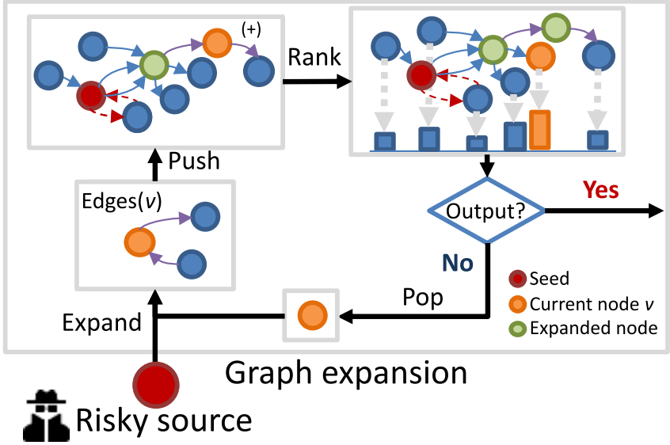

# Graph-based Transaction tracing

The transaction subgraph spiders aim at collecting the transactions (or token transfers) related to specific source
addresses or transactions.
BlockchainSpider provides the following built-in strategies:

- **`BlockchainSpider.strategies.txs.BFS`**: Breadth-First Search.
- **`BlockchainSpider.strategies.txs.Poison`**: taint analysis that only propagates along outgoing transfers.
- **`BlockchainSpider.strategies.txs.Haircut`**: taint analysis that allocates pollution by transfer amount.
- **`BlockchainSpider.strategies.txs.APPR`**: Approximate Personalized PageRank.
- **`BlockchainSpider.strategies.txs.TTRBase`**: Transaction Tracing Rank with uniform edge distribution.
- **`BlockchainSpider.strategies.txs.TTRWeight`**: Transaction Tracing Rank with value-weighted distribution.
- **`BlockchainSpider.strategies.txs.TTRTime`**: time-aware Transaction Tracing Rank.
- **`BlockchainSpider.strategies.txs.TTRRedirect`**: redirect-aware and token-aware Transaction Tracing Rank.

The performance comparison of the above strategies is as follows:


All transaction subgraph spiders are implemented based on the graph expansion framework,
which has four core operations:

- **Expand**: collects all transactions related to a given address or transaction.
- **Push**: merges the collected transactions to the subgraph.
- **Rank**: computes the relevance of addresses in the subgraph to the source node.
- **Pop**: select a node for expanding.



The implementation of different strategies are as follows:

| Strategy    | Push & Rank                                                                 | Pop & Expand                                                      |
|-------------|-----------------------------------------------------------------------------|-------------------------------------------------------------------|
| BFS         | Add expanded neighbors to a queue                                           | Select an unexpanded node in the header of the queue for expanding |
| Poison      | Add expanded out-degree neighbors to a queue                                | Select an unexpanded node in the header of the queue for expanding |
| Haircut     | Allocate the pollution value to neighbors according to the edge weight      | Select an unexpanded node with the highest pollution for expanding |
| APPR        | Use the local push procedure for expanded neighbors                         | Select a node with the highest residual for expanding             |
| TTR family  | Use the TTR local push procedure for expanded neighbors                     | Select a node with the highest residual for expanding             |

Note: for more details, please refer to the paper: [TRacer: Scalable Graph-Based Transaction Tracing for Account-Based Blockchain Trading Systems](https://ieeexplore.ieee.org/abstract/document/10098630).

## How to pass strategy parameters

All strategy parameters are passed through spider arguments with `-a`.
For example, if you use `BlockchainSpider.strategies.txs.BFS` with `depth=3`, the command is:

```shell
scrapy crawl txs.blockscan \
-a source=0xYourSourceAddress \
-a apikeys=YourApiKey1,YourApiKey2 \
-a strategy=BlockchainSpider.strategies.txs.BFS \
-a depth=3
```

The same strategy arguments also work for `txs.tronscan` and `txs.blockchaininfo`.
Only the spider-specific arguments such as `apikeys`, `endpoint`, `enable`, or time/block range are different.

## Strategy parameters

### `BlockchainSpider.strategies.txs.BFS`

Breadth-first expansion over both incoming and outgoing neighbors.

| Parameter | Type | Default | Description |
|-----------|------|---------|-------------|
| `depth`   | int  | `2`     | Maximum expansion depth. `depth=1` means only direct neighbors of the source node are expanded. |

Example:

```shell
scrapy crawl txs.blockscan \
-a source=0xYourSourceAddress \
-a apikeys=YourApiKey1,YourApiKey2 \
-a strategy=BlockchainSpider.strategies.txs.BFS \
-a depth=2
```

### `BlockchainSpider.strategies.txs.Poison`

A simple taint propagation strategy.
Unlike BFS, it only follows outgoing transfers from the current node.

| Parameter | Type | Default | Description |
|-----------|------|---------|-------------|
| `depth`   | int  | `2`     | Maximum forward tracing depth. Only outgoing neighbors are added at each step. |

Example:

```shell
scrapy crawl txs.blockscan \
-a source=0xYourSourceAddress \
-a apikeys=YourApiKey1,YourApiKey2 \
-a strategy=BlockchainSpider.strategies.txs.Poison \
-a depth=3
```

### `BlockchainSpider.strategies.txs.Haircut`

Taint analysis with value allocation.
For each expanded node, the node weight is distributed to outgoing neighbors in proportion to transfer value.

| Parameter    | Type  | Default | Description |
|--------------|-------|---------|-------------|
| `min_weight` | float | `1e-3`  | Minimum pollution weight required for a node to be expanded. The value must be between `0` and `1`. Smaller values usually produce larger subgraphs. |

Example:

```shell
scrapy crawl txs.blockscan \
-a source=0xYourSourceAddress \
-a apikeys=YourApiKey1,YourApiKey2 \
-a strategy=BlockchainSpider.strategies.txs.Haircut \
-a min_weight=0.005
```

### `BlockchainSpider.strategies.txs.APPR`

Approximate Personalized PageRank on the transaction subgraph.
It maintains a rank vector `p` and a residual vector `r`, and always expands the node with the largest residual.

| Parameter | Type  | Default | Description |
|-----------|-------|---------|-------------|
| `alpha`   | float | `0.15`  | Probability mass retained on the current node when pushing residuals. The value must be between `0` and `1`. Larger values concentrate more score near the source node. |
| `epsilon` | float | `1e-5`  | Residual threshold for stopping expansion. The value must be between `0` and `1`. Smaller values usually expand more nodes and cost more time. |

Example:

```shell
scrapy crawl txs.blockscan \
-a source=0xYourSourceAddress \
-a apikeys=YourApiKey1,YourApiKey2 \
-a strategy=BlockchainSpider.strategies.txs.APPR \
-a alpha=0.2 \
-a epsilon=1e-6
```

### `BlockchainSpider.strategies.txs.TTRBase`

The basic Transaction Tracing Rank strategy.
It splits residuals to outgoing and incoming neighbors by edge count.

| Parameter | Type  | Default | Description |
|-----------|-------|---------|-------------|
| `alpha`   | float | `0.15`  | Portion of residual converted into final score on the current node at each push. |
| `beta`    | float | `0.8`   | Portion of the remaining residual propagated to outgoing neighbors. The rest, `1 - beta`, is propagated to incoming neighbors. |
| `epsilon` | float | `1e-3`  | Residual threshold for stopping expansion. Smaller values usually expand more nodes. |

Example:

```shell
scrapy crawl txs.blockscan \
-a source=0xYourSourceAddress \
-a apikeys=YourApiKey1,YourApiKey2 \
-a strategy=BlockchainSpider.strategies.txs.TTRBase \
-a alpha=0.15 \
-a beta=0.8 \
-a epsilon=1e-4
```

### `BlockchainSpider.strategies.txs.TTRWeight`

A value-weighted TTR variant.
Compared with `TTRBase`, residuals are distributed according to transfer amount instead of edge count.

| Parameter | Type  | Default | Description |
|-----------|-------|---------|-------------|
| `alpha`   | float | `0.15`  | Portion of residual converted into final score on the current node at each push. |
| `beta`    | float | `0.8`   | Portion of the remaining residual propagated to outgoing neighbors. The rest is propagated to incoming neighbors. |
| `epsilon` | float | `1e-3`  | Residual threshold for stopping expansion. Smaller values usually expand more nodes. |

Example:

```shell
scrapy crawl txs.blockscan \
-a source=0xYourSourceAddress \
-a apikeys=YourApiKey1,YourApiKey2 \
-a strategy=BlockchainSpider.strategies.txs.TTRWeight \
-a alpha=0.15 \
-a beta=0.9 \
-a epsilon=1e-4
```

### `BlockchainSpider.strategies.txs.TTRTime`

A time-aware TTR variant.
Residuals are propagated according to transaction time order, which is useful when you care about temporal consistency.

| Parameter | Type  | Default | Description |
|-----------|-------|---------|-------------|
| `alpha`   | float | `0.15`  | Portion of residual converted into final score on the current node at each push. |
| `beta`    | float | `0.8`   | Portion of the remaining residual propagated to later outgoing transfers. The rest is propagated to earlier incoming transfers. |
| `epsilon` | float | `1e-3`  | Residual threshold for stopping expansion. Smaller values usually expand more nodes. |

Example:

```shell
scrapy crawl txs.blockscan \
-a source=0xYourSourceAddress \
-a apikeys=YourApiKey1,YourApiKey2 \
-a strategy=BlockchainSpider.strategies.txs.TTRTime \
-a alpha=0.15 \
-a beta=0.8 \
-a epsilon=1e-4
```

### `BlockchainSpider.strategies.txs.TTRRedirect`

A redirect-aware TTR variant.
It aggregates transfers with the same transaction hash and keeps token symbols during propagation, which makes it more suitable for mixed-token fund flow analysis.

| Parameter | Type  | Default | Description |
|-----------|-------|---------|-------------|
| `alpha`   | float | `0.15`  | Portion of residual converted into final score on the current node at each push. |
| `beta`    | float | `0.8`   | Portion of the remaining residual propagated to outgoing transfers. The rest is propagated to incoming transfers. |
| `epsilon` | float | `1e-3`  | Residual threshold for stopping expansion. It is also used internally to stop overly fine-grained redirect splitting. |

Example:

```shell
scrapy crawl txs.blockscan \
-a source=0xYourSourceAddress \
-a apikeys=YourApiKey1,YourApiKey2 \
-a strategy=BlockchainSpider.strategies.txs.TTRRedirect \
-a alpha=0.15 \
-a beta=0.8 \
-a epsilon=1e-4 \
-a enable=BlockchainSpider.middlewares.txs.blockscan.ExternalTransferMiddleware,BlockchainSpider.middlewares.txs.blockscan.Token20TransferMiddleware
```

## Parameter selection suggestions

- Use **`BFS`** when you need a simple baseline and a controllable hop limit.
- Use **`Poison`** when you mainly care about forward fund flow from the source node.
- Use **`Haircut`** when you want taint dilution by transfer amount.
- Use **`APPR`** when you need a ranking-oriented strategy that concentrates score near the source node.
- Use **`TTRBase`** or **`TTRWeight`** when you need bidirectional tracing with residual ranking.
- Use **`TTRTime`** when transaction order matters.
- Use **`TTRRedirect`** when token type and intra-transaction redirect behavior matter.

## Notes

- `BFS` and `Poison` mainly use `depth` to control expansion size.
- `Haircut` mainly uses `min_weight` to control expansion size.
- `APPR` and the `TTR` family mainly use `epsilon` to control expansion size.
- Smaller `epsilon` or `min_weight` usually leads to more nodes being expanded and higher runtime.
- On account-based chains, strategies consume normalized transfer edges with fields such as `from`, `to`, `value`, `timeStamp`, and `symbol`.
- `TTRRedirect` can automatically handle different token types during propagation, so in practice it may collect token transfers beyond a strict `allowed_tokens` filter.

## Customise your own strategy

You can implement your own strategy by inheriting the `BlockchainSpider.strategies.txs.PushPopModel` class.
Here is the simplest example, in which for each Ethereum address, we track only the output money transfer with the
largest Ether value.

**First**, create a new file `mystg.py` in the root directory of the project and declare a `PushPopModel` class:

```python
from typing import Any, Dict, Tuple
from BlockchainSpider.strategies.txs import PushPopModel


class MyStrategy(PushPopModel):
    def __init__(self, source, **kwargs):
        super().__init__(source, **kwargs)
        self.to_be_vis = set()

    def push(self, node, edges: list, **kwargs):
        # node is the address of the current node
        # edges is a list of money transfers related to the current address
        # each edge is a dict with fields adapted from TransferItem, e.g. `AccountTransferItem`
        # please refer to `BlockchainSpider/items/subgraph.py`
        edges = [edge for edge in edges if edge['address_from'] == node]
        if len(edges) == 0:
            return
        edges.sort(key=lambda x: int(x['value']), reverse=True)
        self.to_be_vis.add(edges[0]['address_to'])

    def pop(self) -> Tuple[Any, Dict]:
        if len(self.to_be_vis) == 0:
            return None, {}
        node = self.to_be_vis.pop()

        # the returned dictionary will be used as kwargs for the next push
        # we do not need to pass context here, so return an empty dict
        return node, {}

    def get_context_snapshot(self) -> Dict:
        return {'to be visited': self.to_be_vis}

    def get_node_rank(self) -> Dict:
        return {}
```

**Next**, start the `txs.blockscan` spider and mount the new strategy:

```shell
scrapy crawl txs.blockscan \
-a source=0xYourSourceAddress \
-a apikeys=YourApiKey1,YourApiKey2 \
-a strategy=mystg.MyStrategy
```
